<div align="center">



<a href="https://github.com/mrTimurochka">
  
</a>

<br/><br/>

<a href="https://www.linkedin.com/in/timur-yesmagambetov-2ab416298/"></a>


</div>


## 👾 About me

<table>
<tr>
<td width="55%" valign="top">

I'm a **full-stack developer** who has spent **8+ years** turning messy requirements into fast, clean products for teams in the **US, Germany, Russia and Kazakhstan**.

Right now I'm building at **BAITC — Blockchain & AI Technology Center** in Astana. Before that I was a **Senior Full-stack Developer at Magicly**, shipping high-load web & mobile apps.

- 🧠 Backend: **NestJS, Go, Express, Django** · REST & **GraphQL**
- 🎨 Frontend: **React, Next.js, Vue, Nuxt** · SSR for SEO
- 📱 Mobile: **React Native, Kotlin, Swift**
- ☁️ Infra: **Docker, Nginx, AWS, GCP**
- 🎓 Student at **Astana IT University**

</td>
<td width="45%" valign="top">

```ts
const timur = {
  now:   "BAITC · Astana",
  stack: ["TypeScript", "Go", "Python"],
  front: ["React", "Vue", "Next", "Nuxt"],
  back:  ["NestJS", "Go", "Django"],
  loves: ["high-load", "clean APIs",
          "fast UI", "good DX"],
  open:  true,
};
```

</td>
</tr>
</table>

<div align="center">

| <h2>8+</h2> | <h2>7</h2> | <h2>4</h2> | <h2>2,415</h2> |
|:---:|:---:|:---:|:---:|
| years in production | companies | countries | hackers at our 🏆 Guinness record |

</div>


## 🔮 Tech stack

<div align="center">

<b>Languages</b><br/><br/>


<br/><br/><b>Frontend</b><br/><br/>


<br/><br/><b>Backend & Data</b><br/><br/>


<br/><br/><b>DevOps, Cloud & Tools</b><br/><br/>


</div>


## 💜 Experience

| | Role | Company | When |
|:-:|---|---|---|
| 🟣 | **Full-stack Developer** | **BAITC** — Blockchain & AI Technology Center · Astana | Oct 2025 — *now* |
| 🔮 | **Senior Full-stack Developer** | **Magicly** · USA, remote | Aug 2023 — Sep 2026 |
| 🔬 | Research Assistant (AI) | Astana IT University | Nov 2025 — Jan 2026 |
| 💳 | Frontend Developer | Tinkoff · remote | May 2025 — Sep 2025 |
| 🧩 | Full Stack Engineer | Курсор · Moscow, remote | Apr 2025 — Jun 2025 |
| 🌐 | Frontend Developer | Subsquid · USA, remote | Apr 2020 — Apr 2023 |
| ⚙️ | Back-end Developer | Zoftify · Germany, remote | Mar 2018 — Aug 2021 |

<details>
<summary><b>✨ What I actually did there</b></summary>
<br/>

**Magicly** — high-load web & mobile apps on NestJS / Express / Koa / Django + React / Vue, mobile on React Native / Kotlin / Swift. REST & GraphQL APIs, payments, microservices, performance & SEO, code reviews, Agile/Scrum with design & product.

**Subsquid** — SPA & SSR apps on Next.js / Nuxt, REST + GraphQL + WebSockets, responsive UI with SASS & Tailwind, render optimisation, SSR for SEO, Framer Motion / GSAP animations, tests with Jest, RTL and Cypress.

**Zoftify** — scalable REST APIs, SQL/NoSQL optimisation, Nginx / Apache / Docker, load balancing & clustering, deploys on AWS and Google Cloud.

**Курсор** — responsive Vue.js apps, performance and cross-browser compatibility.

</details>


## 🚀 Featured

<table>
<tr>
<td width="50%" valign="top">

### 🔍 Meta Explorer
A browser extension for **real-time SEO audits** — spots SEO issues, highlights broken links and tells you exactly what to fix.

  

</td>
<td width="50%" valign="top">

### 🏆 HackAlem AI
Part of the team behind the **largest agentic-AI hackathon** — **2,415** people in one day in Astana, an official **Guinness World Record**. Backed by OpenAI, NVIDIA and ASU.

  

</td>
</tr>
</table>


## 📊 GitHub stats

<div align="center">


</div>

<br/>

<div align="center">

</div>


<div align="center">

### 🤝 Let's build something

Open to full-stack, AI and product roles — office, hybrid or remote.

<a href="https://www.linkedin.com/in/timur-yesmagambetov-2ab416298/"></a>

</div>


